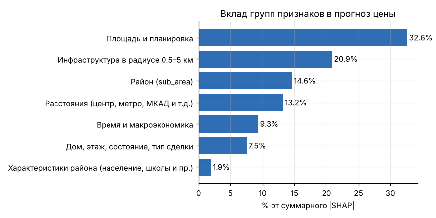
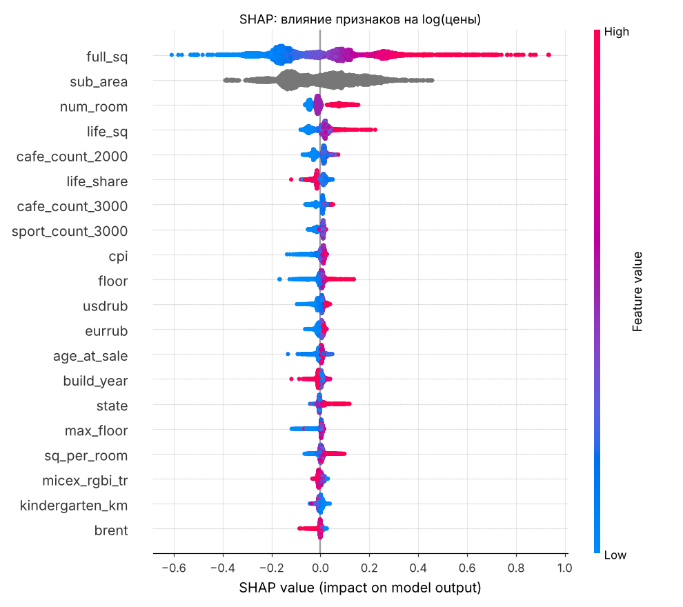
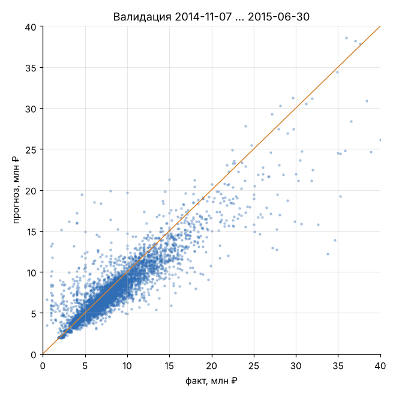

# Цены на жильё в Москве: Sberbank Russian Housing Market

Очистка данных, EDA, градиентный бустинг (LightGBM) и объяснение модели через SHAP.

## Главный вывод: что сильнее всего влияет на цену

Доля от суммарного вклада признаков в прогноз (средний |SHAP|, файл `shap_importance_by_group.csv`):

| Группа признаков | Вклад |
|---|---|
| Площадь и планировка (`full_sq`, `life_sq`, `num_room` и др.) | **32,6%** |
| Инфраструктура вокруг (кафе, спорт, офисы, ТЦ в радиусе 0,5–5 км) | 20,9% |
| Район (`sub_area`) | 14,6% |
| Расстояния (до центра, метро, МКАД, ж/д и т.д.) | 13,2% |
| Время и макроэкономика (курс, инфляция, ставки, нефть) | 9,3% |
| Дом: этаж, этажность, год постройки, состояние, тип сделки | 7,5% |
| Прочие характеристики района (население, школы, больницы) | 1,9% |



1. **Общая площадь — фактор номер один** (21% всего вклада одним признаком). Квартира 79 м² (90-й перцентиль) при прочих равных стоит примерно в **2 раза** дороже квартиры 34 м² (10-й перцентиль). Число комнат и жилая площадь добавляют ещё около 10–13% каждая сверх общей площади.
2. **Локация в сумме важнее площади.** Район, плотность инфраструктуры и расстояния вместе дают почти половину (≈49%) вклада. Сам район (`sub_area`) стоит на втором месте среди отдельных признаков: медиана цены за м² по районам (где ≥30 сделок) отличается в 6 раз, от 45 до 274 тыс. ₽. Количество кафе и спортобъектов в радиусе 2–3 км работает как мера «центральности»: это не кафе повышают цену, а центр города.
3. **Макроэкономика влияет заметно слабее** (≈9%): рост инфляции (CPI) и курса доллара сопровождался ростом рублёвых цен, но в пределах нескольких процентов.
4. **Характеристики дома вторичны** (≈7,5%): низкие этажи (1–2) и малоэтажные дома дешевле; хорошее состояние (`state` = 3–4) повышает цену.



Как читать: каждая точка — сделка; правее нуля значит, что признак повышает цену; красный цвет означает большое значение признака.

## Данные

* Источник: соревнование Kaggle [Sberbank Russian Housing Market](https://www.kaggle.com/c/sberbank-russian-housing-market) (2017). Скрипт `download_data.py` берёт файлы из публичной копии на GitHub (на Kaggle нужен аккаунт и принятые правила соревнования) ([catherinehata/Sberbank-Russian-Housing-Market](https://github.com/catherinehata/Sberbank-Russian-Housing-Market)); размеры совпадают с оригиналом: `train` 30 471 × 292, `test` 7 662 × 291, `macro` 2 484 × 100.
* **Актуальность.** Это самые свежие данные Сбербанка такого рода в открытом доступе: сделки в `train` с цены идут с 20.08.2011 по 30.06.2015, `test` (без цен) с 01.07.2015 по 30.05.2016, макропоказатели до 19.10.2016. Сбербанк больше не публиковал обновлений этого датасета. Поэтому выводы описывают московский рынок 2011–2015 годов, а не текущий.
* В `test` нет целевой переменной, поэтому модель обучена и проверена только на `train`; `test` лежит в `data/` для полноты.

## Очистка

* Пропуски до очистки: 51 признак из 292, 2,9% всех ячеек. Больше всего у `hospital_beds_raion` (47%), `build_year` (45%), `state` (44%), цены кафе в радиусе 500 м (44%), `kitch_sq`/`material`/`max_floor`/`num_room` (31%). См. `missing_before.csv` и `figures/01_missing.png`.
* Явные ошибки переведены в пропуски: `full_sq` < 10 или > 1000 м² (30), `life_sq` > `full_sq` или < 5 м² (465), `kitch_sq` ≥ `full_sq` или < 2 м² (6 287), `build_year` вне 1860–2018 (906, например 0, 1, 20052009), `floor` > `max_floor` или `max_floor` = 0 (1 497), `num_room` = 0 (14). Опечатка `state` = 33 исправлена на 3.
* Удалены 1 833 инвестиционные сделки с ценой ровно 1, 2 или 3 млн ₽: это известная особенность датасета (заниженная цена в договоре), а не рыночная цена.
* Заполнение: числовые признаки медианой по району, если её нет, то общей медианой; категориальные модой. Для признаков, где пропусков больше 20%, добавлен флаг `<признак>_isna`. После очистки пропусков 0; итог 28 638 строк (`train_clean.csv.gz`).
* Присоединены 18 макропоказателей по дате сделки и добавлены признаки: год, месяц, доля жилой площади, этаж/этажность, м² на комнату, возраст дома на момент продажи.

## EDA (кратко)

* Цена сильно скошена вправо (медиана 6,3 млн ₽), поэтому модель обучается на `log(1 + цена)` (`figures/02_price_distribution.png`).
* Цена почти линейно растёт с площадью (`figures/03_price_vs_area.png`).
* Провал медианы за м² в конце 2012 – середине 2013 года объясняется составом сделок, а не падением рынка: доля дешёвых новостроек (`OwnerOccupier`, в основном на окраинах) выросла до 50–70%. На вторичке цена м² росла равномерно, со 136 до 170 тыс. ₽ (`figures/04_price_sqm_time.png`, пунктир).
* Самые дорогие и дешёвые районы: `figures/05_sub_area.png`. Корреляции Спирмена: `figures/06_correlations.png`, `spearman_top20.csv`.

## Модель

LightGBM, целевая переменная `log(1 + price_doc)`, 334 признака, `sub_area` и `product_type` как категориальные. Валидация по времени: обучение на первых 80% сделок, проверка на последних 20% (07.11.2014 – 30.06.2015), как и в соревновании, где test идёт после train.

| Метрика на валидации | LightGBM | Базовая (медиана) |
|---|---|---|
| RMSLE | **0,254** | 0,513 |
| R² (на log цены) | 0,736 | 0 |
| MAPE | 17,6% | — |

Для сравнения: победители соревнования получали около 0,31 RMSLE на закрытом тесте (с фейковыми ценами внутри), так что цифры напрямую не сравнимы, но порядок разумный. Финальная модель переобучена на всех данных (`lgbm_model.txt`); SHAP считался по ней на 5 000 случайных сделках всего периода.



## Запуск

```bash
pip install -r requirements.txt
python download_data.py          # train.csv, test.csv, macro.csv в data/
python analysis.py data .        # очистка, EDA, модель, SHAP; пишет файлы и figures/ сюда
```

## Файлы

| Файл | Что внутри |
|---|---|
| `analysis.py` | весь пайплайн: очистка, EDA, LightGBM, SHAP |
| `download_data.py` | скачивание исходных данных в `data/` |
| `figures/` | 14 графиков: пропуски, EDA, SHAP, зависимости |
| `shap_importance.csv` | средний \|SHAP\| и доля для каждого признака |
| `shap_importance_by_group.csv` | вклад групп признаков |
| `spearman_top20.csv` | 20 признаков с наибольшей корреляцией Спирмена с ценой |
| `missing_before.csv` | доля пропусков по признакам до очистки |
| `report.json` | все числа: исправления, метрики, эффекты |

`train_clean.csv.gz` (очищенный train, 17 МБ) и `lgbm_model.txt` (обученная модель, 2,5 МБ) в репозиторий не входят: их создаёт `analysis.py`.
