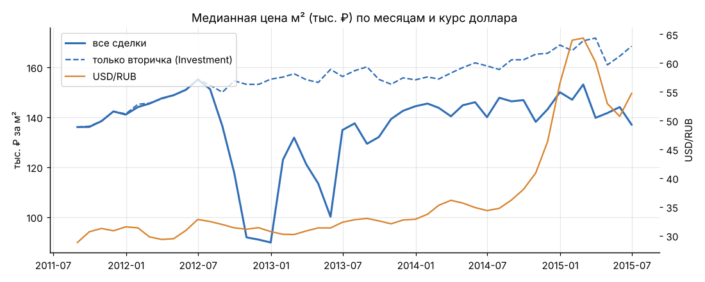
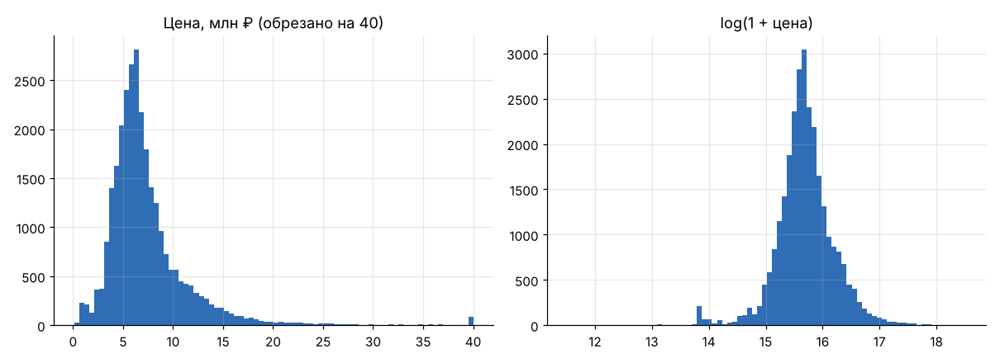
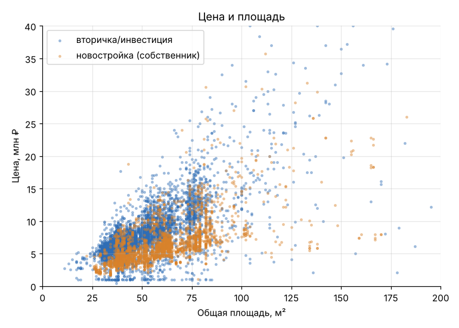
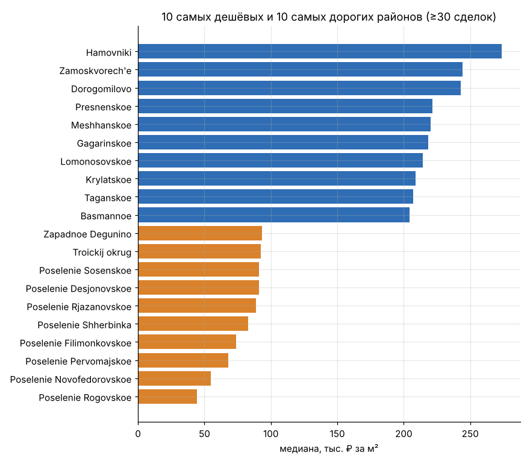
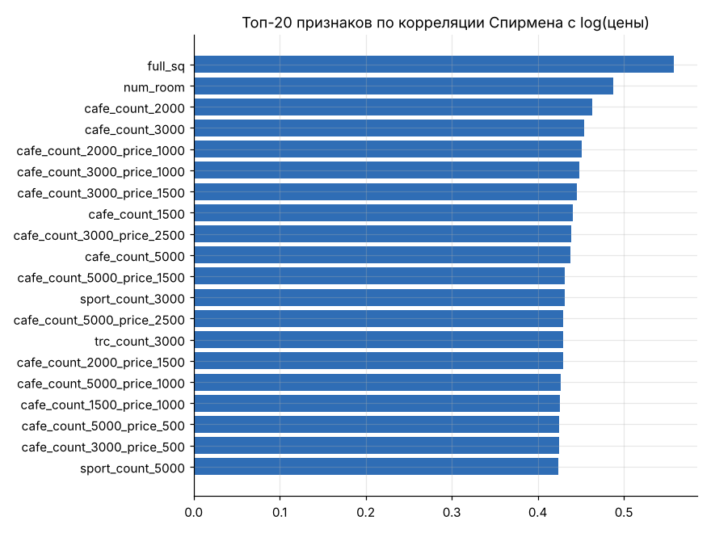
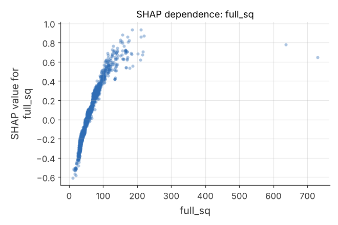
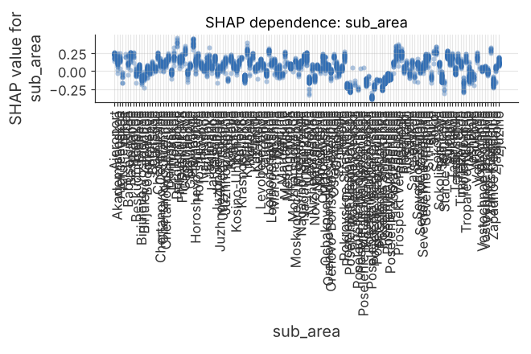
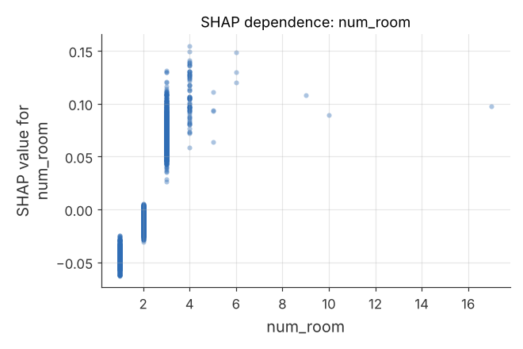
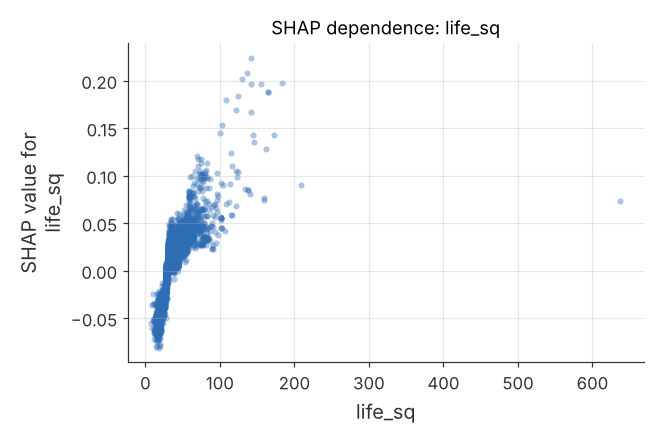

# Цены на жильё в Москве: Sberbank Russian Housing Market

Что определяет цену квартиры в Москве: LightGBM по сделкам 2011–2015 годов (RMSLE **0.254** на валидации по времени против **0.513** у медианы) и разбор через SHAP — прежде всего площадь и локация.


*Вклад групп признаков в прогноз цены: доля от суммарного среднего |SHAP| по 5 000 сделкам.*

## Ключевые результаты

- **RMSLE 0.254** на валидации по времени (последние 20% сделок) против 0.513 у прогноза медианой; R² на log-цене 0.736, MAPE 17.6%.
- **Площадь и планировка дают 32.6%** вклада в прогноз, одна общая площадь — 21%. Квартира 79 м² при прочих равных стоит примерно **в 2 раза** дороже квартиры 34 м².
- **Локация в сумме даёт около 49%**: район, инфраструктура вокруг и расстояния. Медиана цены за м² по районам (≥30 сделок) различается в 6 раз, от 45 до 274 тыс. ₽.
- **Макроэкономика (≈9%) и характеристики дома (≈7.5%)** влияют заметно слабее.
- **После очистки осталось 28 638 сделок из 30 471** и ноль пропусков: удалены 1 833 сделки с заниженной ценой в договоре, явные ошибки переведены в пропуски и заполнены.

## Содержание

- [Задача](#задача)
- [Данные](#данные)
- [Подход](#подход)
- [Результаты](#результаты)
- [Ограничения](#ограничения)
- [Структура проекта](#структура-проекта)
- [Запуск](#запуск)

## Задача

Понять, что сильнее всего влияет на цену квартиры в Москве. Пайплайн: очистка данных, EDA, градиентный бустинг (LightGBM) на `log(1 + цена)` и объяснение прогноза модели через SHAP.

## Данные

Источник: соревнование Kaggle [Sberbank Russian Housing Market](https://www.kaggle.com/c/sberbank-russian-housing-market) (2017).

| Файл | Размер | Период | Цена сделки |
|---|---|---|---|
| `train.csv` | 30 471 × 292 | 20.08.2011 – 30.06.2015 | есть |
| `test.csv` | 7 662 × 291 | 01.07.2015 – 30.05.2016 | нет |
| `macro.csv` | 2 484 × 100 | до 19.10.2016 | — |

На Kaggle нужен аккаунт и принятые правила соревнования, поэтому `download_data.py` берёт файлы из публичной копии на GitHub ([catherinehata/Sberbank-Russian-Housing-Market](https://github.com/catherinehata/Sberbank-Russian-Housing-Market)). Размеры совпадают с оригиналом.

Это самые свежие данные Сбербанка такого рода в открытом доступе; что из этого следует для выводов, см. в разделе [Ограничения](#ограничения).

### Очистка данных

**Пропуски до очистки:** 51 признак из 292, 2.9% всех ячеек. Больше всего у `hospital_beds_raion` (47%), `build_year` (45%), `state` (44%), цен кафе в радиусе 500 м (44%) и `kitch_sq` / `material` / `max_floor` / `num_room` (31%). Подробно: [`missing_before.csv`](missing_before.csv) и [`figures/01_missing.png`](figures/01_missing.png).

**Явные ошибки переведены в пропуски:**

| Правило | Случаев |
|---|---:|
| `full_sq` < 10 или > 1 000 м² | 30 |
| `life_sq` > `full_sq` или < 5 м² | 465 |
| `kitch_sq` ≥ `full_sq` или < 2 м² | 6 287 |
| `build_year` вне 1860–2018 (например, 0, 1, 20052009) | 906 |
| `floor` > `max_floor` или `max_floor` = 0 | 1 497 |
| `num_room` = 0 | 14 |

Опечатка `state` = 33 исправлена на 3.

**Удалены 1 833 инвестиционные сделки** с ценой ровно 1, 2 или 3 млн ₽. Это известная особенность датасета (заниженная цена в договоре), а не рыночная цена.

**Заполнение пропусков:**

- числовые признаки заполнены медианой по району, а если её нет, общей медианой; категориальные — модой;
- для признаков, где пропусков больше 20%, добавлен флаг `<признак>_isna`;
- после очистки пропусков 0, итог — 28 638 строк (`train_clean.csv.gz`).

**Новые признаки:** присоединены 18 макропоказателей по дате сделки; добавлены год, месяц, доля жилой площади, этаж/этажность, м² на комнату, возраст дома на момент продажи.

### EDA

- Цена сильно скошена вправо (медиана 6.3 млн ₽), поэтому модель обучается на `log(1 + цена)`.
- Цена почти линейно растёт с площадью.
- Провал медианы за м² в конце 2012 – середине 2013 года объясняется составом сделок, а не падением рынка: доля дешёвых новостроек (`OwnerOccupier`, в основном на окраинах) выросла до 50–70%. На вторичке цена м² росла равномерно, со 136 до 170 тыс. ₽ (пунктир на графике).



*Медианная цена м² по месяцам: все сделки, только вторичка (пунктир) и курс USD/RUB.*

<details>
<summary><b>Остальные графики EDA: распределение цены, цена и площадь, районы, корреляции</b></summary>



*Распределение цены и `log(1 + цена)`.*



*Цена и общая площадь.*



*Самые дорогие и самые дешёвые районы по цене м² (≥30 сделок).*



*Корреляции Спирмена с log(цены), таблица — [`spearman_top20.csv`](spearman_top20.csv).*

</details>

## Подход

| Параметр | Значение |
|---|---|
| Алгоритм | LightGBM |
| Целевая переменная | `log(1 + price_doc)` |
| Признаки | 334; `sub_area` и `product_type` — категориальные |
| Валидация | по времени: обучение на первых 80% сделок, проверка на последних 20% (07.11.2014 – 30.06.2015) |
| Финальная модель | переобучена на всех данных (`lgbm_model.txt`) |
| SHAP | по финальной модели, на 5 000 случайных сделках всего периода |

Валидация по времени повторяет устройство соревнования, где `test` идёт после `train`.

## Результаты

### Качество прогноза

| Метрика на валидации | LightGBM | Базовая (медиана) |
|---|---:|---:|
| RMSLE | **0.254** | 0.513 |
| R² (на log цены) | 0.736 | 0 |
| MAPE | 17.6% | — |

Для сравнения: победители соревнования получали около 0.31 RMSLE на закрытом тесте (с фейковыми ценами внутри), так что цифры напрямую не сравнимы, но порядок разумный.


*Прогноз против факта на валидации, млн ₽ (оси обрезаны на 40 млн); линия — идеальный прогноз.*

### Что сильнее всего влияет на цену

Доля от суммарного вклада признаков в прогноз (средний |SHAP|, [`shap_importance_by_group.csv`](shap_importance_by_group.csv); по отдельным признакам — [`shap_importance.csv`](shap_importance.csv)):

| Группа признаков | Вклад |
|---|---:|
| Площадь и планировка (`full_sq`, `life_sq`, `num_room` и др.) | **32.6%** |
| Инфраструктура вокруг (кафе, спорт, офисы, ТЦ в радиусе 0.5–5 км) | 20.9% |
| Район (`sub_area`) | 14.6% |
| Расстояния (до центра, метро, МКАД, ж/д и т.д.) | 13.2% |
| Время и макроэкономика (курс, инфляция, ставки, нефть) | 9.3% |
| Дом: этаж, этажность, год постройки, состояние, тип сделки | 7.5% |
| Прочие характеристики района (население, школы, больницы) | 1.9% |

1. **Общая площадь — фактор номер один** (21% всего вклада одним признаком). Квартира 79 м² (90-й перцентиль) при прочих равных стоит примерно в 2 раза дороже квартиры 34 м² (10-й перцентиль). Число комнат и жилая площадь добавляют ещё около 10–13% каждая сверх общей площади.
2. **Локация в сумме важнее площади.** Район, плотность инфраструктуры и расстояния вместе дают почти половину (≈49%) вклада. Сам район (`sub_area`) стоит на втором месте среди отдельных признаков: медиана цены за м² по районам (≥30 сделок) отличается в 6 раз, от 45 до 274 тыс. ₽. Количество кафе и спортобъектов в радиусе 2–3 км работает как мера «центральности»: это не кафе повышают цену, а центр города.
3. **Макроэкономика влияет заметно слабее** (≈9%): рост инфляции (CPI) и курса доллара сопровождался ростом рублёвых цен, но в пределах нескольких процентов.
4. **Характеристики дома вторичны** (≈7.5%): низкие этажи (1–2) и малоэтажные дома дешевле; хорошее состояние (`state` = 3–4) повышает цену.


*SHAP-вклад 20 главных признаков по 5 000 сделкам. Как читать: каждая точка — сделка; правее нуля значит, что признак повышает цену; красный цвет означает большое значение признака.*

Зависимость SHAP-вклада от значения признака для четырёх самых важных признаков:

<table>
  <tr>
    <td width="50%"><br><em>Зависимость SHAP: <code>full_sq</code>.</em></td>
    <td width="50%"><br><em>Зависимость SHAP: <code>sub_area</code>.</em></td>
  </tr>
  <tr>
    <td width="50%"><br><em>Зависимость SHAP: <code>num_room</code>.</em></td>
    <td width="50%"><br><em>Зависимость SHAP: <code>life_sq</code>.</em></td>
  </tr>
</table>

Средний |SHAP| по 20 главным признакам: [`figures/09_shap_bar.png`](figures/09_shap_bar.png).

## Ограничения

- **Данные 2011–2015 годов.** Сделки в `train` заканчиваются 30.06.2015, макропоказатели — 19.10.2016. Сбербанк больше не публиковал обновлений этого датасета, поэтому выводы описывают московский рынок 2011–2015 годов, а не текущий.
- **В `test` нет цен.** Поэтому модель обучена и проверена только на `train`; `test` лежит в `data/` для полноты.
- **Важность признака не означает причину.** Кафе и спортобъекты вокруг важны для модели как мера близости к центру, а не как самостоятельный фактор цены (см. вывод 2 в разделе [Результаты](#результаты)).

## Структура проекта

```text
sberbank-housing/
├── analysis.py                    # весь пайплайн: очистка, EDA, LightGBM, SHAP
├── download_data.py               # скачивание исходных данных в data/
├── requirements.txt
├── figures/                       # 14 графиков: пропуски, EDA, SHAP, зависимости
├── shap_importance.csv            # средний |SHAP| и доля для каждого признака
├── shap_importance_by_group.csv   # вклад групп признаков
├── spearman_top20.csv             # 20 признаков с наибольшей корреляцией Спирмена с ценой
├── missing_before.csv             # доля пропусков по признакам до очистки
└── report.json                    # все числа: исправления, метрики, эффекты
```

`data/`, `train_clean.csv.gz` (очищенный train, 17 МБ) и `lgbm_model.txt` (обученная модель, 2.5 МБ) в репозиторий не входят: данные скачивает `download_data.py`, остальное создаёт `analysis.py`.

## Запуск

```bash
pip install -r requirements.txt
python download_data.py          # train.csv, test.csv, macro.csv в data/
python analysis.py data .        # очистка, EDA, модель, SHAP; пишет файлы и figures/ сюда
```
